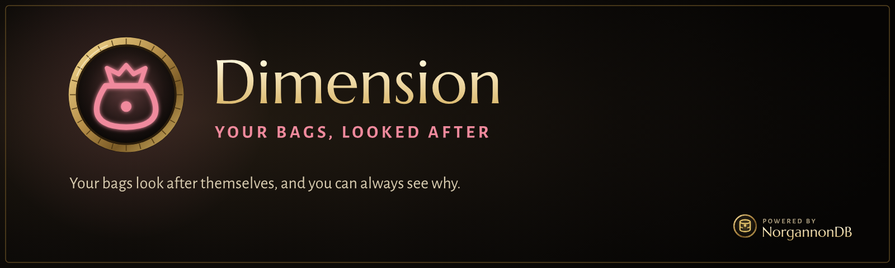

  

  
  
  

> [!WARNING]
> **Very much a work in progress.** This first build has passed its test harness but hasn't been
> played in the game yet, so expect things to need fixing. `/dim probe` tests what your client allows.

**Dimension looks after your bags, and can always say why it did something.** It sells what's safe, frees
space when bags fill up, runs bank trips and keeps things in their places. It adds to the game's own bags
rather than replacing them.

## What it does

### Rules you can read
Every item gets a verdict and a reason, on its tooltip: "Sells at the next vendor: Grey" or "Kept: Reward from
The Valor Family". Protections are checked first, so a selling rule can't reach a quest item, a quest reward, a
rare or a recipe. NorgannonDB knows what a quest wants and what a recipe uses, and Retrospect, if you have it,
knows what your other characters could use. Hover anything and press your Mark key for Junk or Keep.

### At a vendor
Sells what the rules allow and repairs, with an undo beside each sale. The game's buyback list holds 12 stacks,
so a visit sells 12 and stops, cheapest first. Anything more waits for your click. It can also buy what your
carry list is short of, up to a cap, if you turn that on.

### When bags fill up
Partial stacks merge by themselves if you want. **Make room** shows what's next: things that cost nothing, what
the next vendor will take, and the cheapest things no rule wants. Destroying is off until you opt in, and it's
one click per stack. Nothing is ever destroyed by itself: the game doesn't allow it, and neither would we.

### At the bank
One carry list and one stash list, run both ways. Pinned slots never move.

### Places
Pin an item to a slot. Tidy uses the game's own sort, then puts pinned items back. Set what each bag is for
with the game's own filters.

### History
Everything it sold or moved, and why, for 30 days.

### Careful by design
Nothing is automatic until you choose how much it should do. Everything stops in combat and while you're holding
an item, then carries on by itself. It picks up and places items rather than "using" them, so a vendor closing
mid-sale can't make you drink the potion.

## Commands

`/dim` opens the window. `/dim tidy`, `/dim room`, `/dim settings`, and `/dim probe [sell | move | sort]`.
Key bindings for opening, marking, pinning and tidying are in the game's Key Bindings, under AddOns.

## Needs

[NorgannonDB](https://github.com/zmarotrix/NorgannonDB) and [NorgannonDB_Core](https://github.com/zmarotrix/NorgannonDB_Core).

## License

All Rights Reserved. See [LICENSE](LICENSE).
